# Comparing Mixed Models and Hierarchical Bayes

[](https://colab.research.google.com/github/iknyazeva/bayes-cogsci-book/blob/main/notebooks/colab/09_mixed_models_linear.ipynb) · [Русская тетрадь](https://colab.research.google.com/github/iknyazeva/bayes-cogsci-book/blob/main/notebooks/colab/09_mixed_models_linear_ru.ipynb)
[](https://colab.research.google.com/github/iknyazeva/bayes-cogsci-book/blob/main/notebooks/colab/10_mixed_models_logistic.ipynb) · [Русская тетрадь](https://colab.research.google.com/github/iknyazeva/bayes-cogsci-book/blob/main/notebooks/colab/10_mixed_models_logistic_ru.ipynb)

This page works through the two Going Further examples of Lessons 9 and 10 in full — the workbooks [Mixed models (linear)](https://colab.research.google.com/github/iknyazeva/bayes-cogsci-book/blob/main/notebooks/colab/09_mixed_models_linear.ipynb) and [Mixed models for binary data](https://colab.research.google.com/github/iknyazeva/bayes-cogsci-book/blob/main/notebooks/colab/10_mixed_models_logistic.ipynb). The first example is about the effect of sleep deprivation on reaction time, the second about a longitudinal clinical trial of depression treatment. In both we follow the same route: ordinary models that ignore the grouping of the data, then mixed models with random effects, and finally Bayesian hierarchical models. Every figure and every number on this page comes from actually executing the code from the workbooks.

## Part 1. Sleep deprivation and reaction time

### The data

When we discussed the conditions behind the linear model, we singled out the requirement that observations be independent. This is a genuinely important requirement: when it is violated, the model's estimates are incorrect and no valid conclusions can be drawn. Very often, however, observations are grouped: the same measurements at different time points, measurements from several organizations, repeated measurements of one person — any situation with clusters and within-cluster correlation.

The classic example is the `sleepstudy` experiment (Belenky et al., 2003). On the night before the study, 18 subjects slept a full night; on each of the following 9 nights they slept only 3 hours. Reaction time was measured every day. In total, 180 observations: 18 people for 10 days each.

The research question: how does reaction time change with the duration of sleep deprivation — both the overall effect and the individual differences.

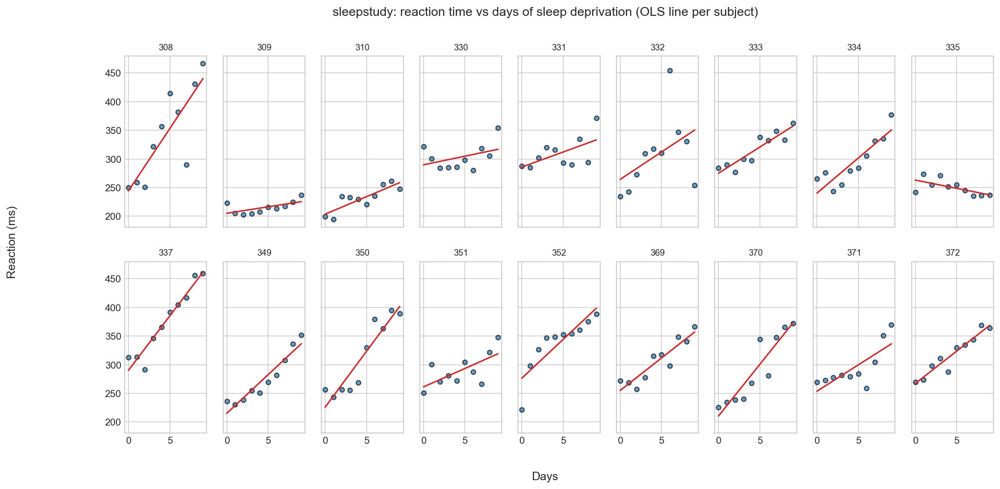

The differences between people are enormous: subject 308 starts fast and barely degrades, subject 337 starts slower and loses hundreds of milliseconds by the end. Everyone has their own baseline and their own rate of slowing. The model must be able to say something about the population average and about a specific person — without confusing the two.

### Ordinary linear model

Let us start with familiar tools. Model 1 is a simple regression of reaction time on days of deprivation, all 180 points pooled:

```python
lm_basic = smf.ols(formula="Reaction ~ Days", data=data).fit()
```

Estimates: intercept ≈ 251.8 ms, slope ≈ 10.5 ms per day of deprivation. In the summary the only alarm bell is the Durbin–Watson statistic, ours being 0.695. An important clarification: Durbin–Watson tests the autocorrelation of residuals in row order, not collinearity of predictors. A value near 2 means no autocorrelation; 0.7 means strong positive autocorrelation — consecutive rows belong to the same subject, so their errors are similar. A rough rule of thumb: values between about 1 and 3 are usually unremarkable; clear departures from 2 call for investigation.

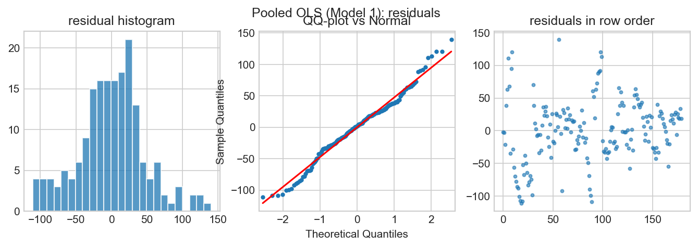

A Shapiro test rejects normality of the residuals, but the main problem is not the shape of the distribution — it is the structure: one person's residuals are alike. Look at the model's predictions with confidence bands:

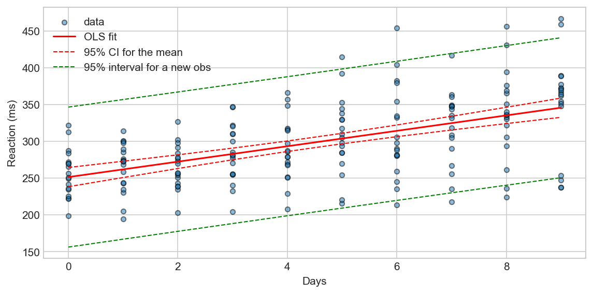

The bands look reassuring, but they are computed under the assumption of 180 independent observations, while the actual independent units number only 18 — the subjects. The standard errors are deflated by roughly a factor of $\sqrt{10}$.

Model 2 adds subject dummies — a separate intercept correction for every person:

```python
lm_sub = smf.ols(formula="Reaction ~ Days + C(Subject)", data=data).fit()
```

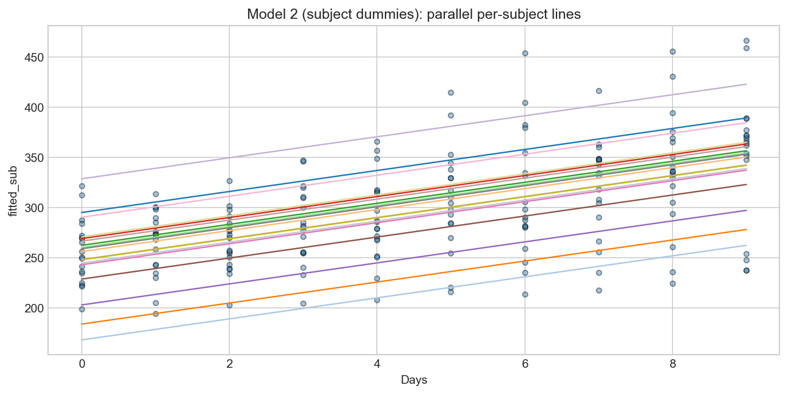

The problem of correlated residuals is essentially resolved (Durbin–Watson is now 1.28), but three inconveniences appear. First, 18 extra parameters come with no "knowledge" of what these people are: a noisy subject gets as extreme an intercept as their noise demands. Second, the slope is still common to everyone, although the panels show that the rate of slowing is individual. Third, universality is lost: a prediction is possible only for a subject already seen — a dummy for a new person does not exist.

### A mixed model with a random intercept

A mixed model includes fixed effects — coefficients shared by the whole population (the average intercept and the average slope) — and random effects — deviations that vary from group to group and are assumed to be drawn from a distribution. The random-intercept model is

$$Reaction_{ij} = \beta_0 + \beta_1 Days_{ij} + b_i + \varepsilon_{ij}, \qquad b_i \sim N(0, \sigma_b^2), \quad \varepsilon_{ij} \sim N(0, \sigma^2),$$

where $i$ indexes subjects and $j$ days. In R this is `lmer(Reaction ~ Days + (1 | Subject))`; in Python:

```python
lm_mixed = smf.mixedlm("Reaction ~ Days", data, groups=data["Subject"]).fit()
```

Take the variance components from the fitted object rather than recomputing them by hand from the summary: the random-effect variance is 1378.2, i.e. $\hat\sigma_b = 37.1$ ms — the standard deviation of individual baselines; the residual variance is 960.5, i.e. $\hat\sigma = 31.0$ ms. The intraclass correlation is ICC $= 1378.2/(1378.2+960.5) = 0.59$: about 60% of the variation not explained by days lives between people. That is precisely the correlation the first model pretended not to see.

The subject shifts the model prints (`random_effects`) are BLUPs, conditional modes: point predictions of $b_i$ given the estimated variances. They are worth a look:

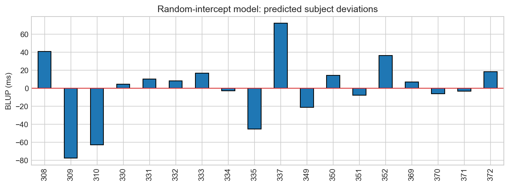

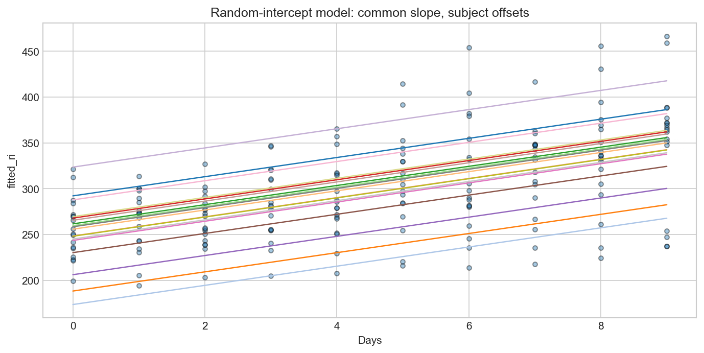

The residuals improved, but a systematic trend across days remains:

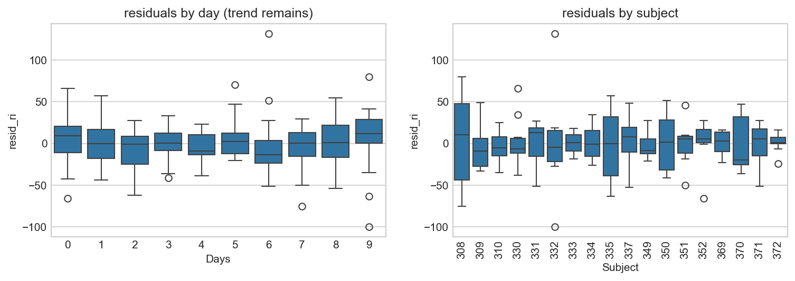

### A confidence band for the population line

For the mean line $\mu(x) = \beta_0 + \beta_1 x$ it is useful to build a confidence band. A common mistake: plugging in both lower (or both upper) confidence limits of $\beta_0$ and $\beta_1$ at once. That traces a "rectangle" in parameter space: the covariance of the estimates is ignored, and uncertainty is overstated. The correct pointwise band uses the covariance matrix of the fixed effects:

$$\widehat{\mathrm{se}}\big(\hat\mu(x)\big) = \sqrt{\mathbf{x}^{\top} \, \widehat{\operatorname{Cov}}(\hat\beta)\, \mathbf{x}}, \qquad \hat\mu(x) \pm z_{0.975}\,\widehat{\mathrm{se}}.$$

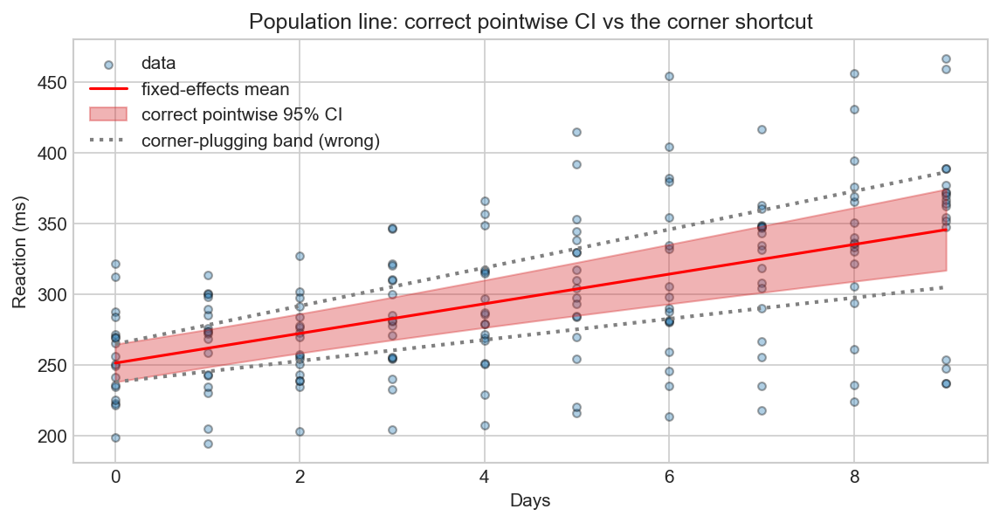

The gray dotted line shows the incorrect "corner" band — it is visibly wider than the correct one. The correct band also has limits of its own: it ignores the uncertainty of the variance components themselves, and it describes the population mean, not the trajectory of a new subject.

### Random intercept and random slope

Since the rate of slowing is individual, add a random slope:

$$Reaction_{ij} = \beta_0 + \beta_1 Days_{ij} + b_i + c_i Days_{ij} + \varepsilon_{ij}, \qquad (b_i, c_i) \sim N\!\left(\mathbf{0}, \begin{bmatrix} \sigma_b^2 & \rho\sigma_b\sigma_c \\ \rho\sigma_b\sigma_c & \sigma_c^2 \end{bmatrix}\right).$$

In R: `lmer(Reaction ~ Days + (1 + Days | Subject))`; in statsmodels random slopes are added via `re_formula`:

```python
lm_mixed = smf.mixedlm("Reaction ~ Days", data, groups=data["Subject"],
                       re_formula="~ Days").fit()
```

Now every subject has two parameters — their own shift and their own sensitivity to sleep loss. Estimates: $\hat\sigma_b = 24.7$ ms, $\hat\sigma_c = 5.9$ ms/day, covariance 9.6.

Here a common misconception deserves dispelling: statsmodels with `re_formula="~ Days"` **does** estimate the full random-effects covariance matrix — in the summary it appears as `Group x Days Cov`. That is, statsmodels estimates the correlation $\rho$ just as `lme4` does. The limitation lies elsewhere: statsmodels reports no standard error or confidence interval for $\rho$ or for the other variance components.

Read the correlation from the model's covariance matrix: $\hat\rho = 9.6/\sqrt{612.1 \cdot 35.1} = 0.066$. The sample correlation of the BLUP cloud is 0.264 — and that is not the same thing: BLUPs are shrunk predictions, not parameter estimates, and their correlation conflates shrinkage with the true $\rho$.

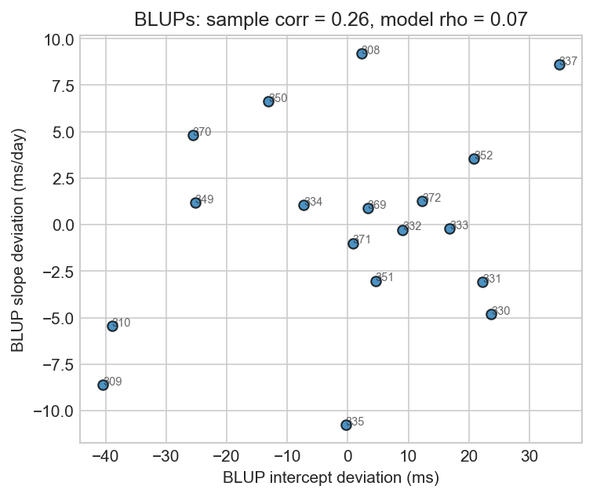

Residuals of the random-slope model by day and by subject:

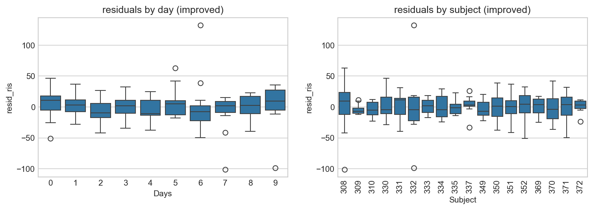

The box plots are noticeably flatter: the model has absorbed both the individual baselines and the individual rates of slowing.

### How to test hypotheses and choose models

For model choice, likelihood-based criteria are used (the likelihood itself, AIC, BIC). The "presence of an effect" is harder: for mixed models, confidence intervals and t-statistics can only be obtained approximately; to avoid misleading users, `lme4` does not report significance levels at all. The classical way out is the parametric bootstrap. Another way out is Bayesian models: there the task is posed differently (Monte Carlo or variational inference), and the output consists of posterior distributions over all parameters, including the variances of the random effects.

### The Bayesian hierarchical model in Bambi

The [Bambi](https://bambinos.github.io/bambi/) package uses `lme4`-style formulas and takes care of priors and internal parameterization:

```python
model1 = bmb.Model("Reaction ~ 1 + Days + (1 | Subject)", data, categorical="Subject")
idata1 = model1.fit(draws=1000, tune=1000, chains=4, random_seed=2026)

model2 = bmb.Model("Reaction ~ 1 + Days + (Days | Subject)", data, categorical="Subject")
idata2 = model2.fit(draws=1000, tune=1000, chains=4, random_seed=2026)
```

The results agree with the classical models: intercept ≈ 251.4 ms, slope ≈ 10.5 ms/day, $\hat\sigma_b \approx 40$ ms (model 1) and $\approx 25$ ms (model 2), $\hat\sigma_c \approx 6$ ms/day. Before reading on, it is worth checking the `r_hat` and ESS columns of the `az.summary` output — convergence is fine here.

Model comparison uses out-of-sample predictive accuracy, PSIS-LOO (earlier versions of this course used WAIC; current ArviZ ships only LOO):

```python
az.compare({"model1": idata1, "model2": idata2})
```

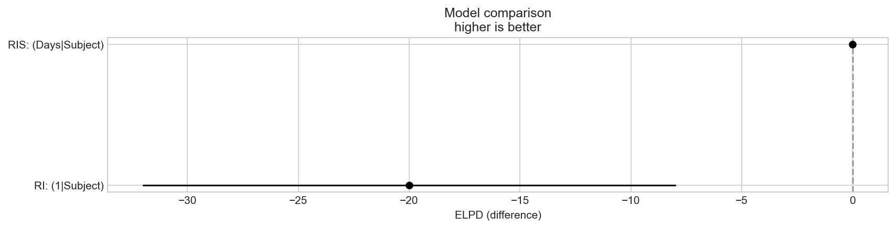

The random-slope model is clearly better in predictive accuracy (a difference on the order of 25 ELPD units): the individual slopes carry real information. This confirms what was visible by eye in the panels.

One caveat worth knowing: in Bambi, group effects in a formula like `(Days | Subject)` are by default independent — their correlation is not estimated (unlike `lme4` and unlike the statsmodels mixed model above). For these data this is not critical: we have already seen that the model estimate of the correlation is small (0.066). If the correlation itself is the object of study, the correlated model is written by hand in PyMC.

Now the main difference from the classical model: every subject has a full posterior distribution instead of a point estimate. In the figure below, each little cloud is the joint posterior of one subject's shifts:

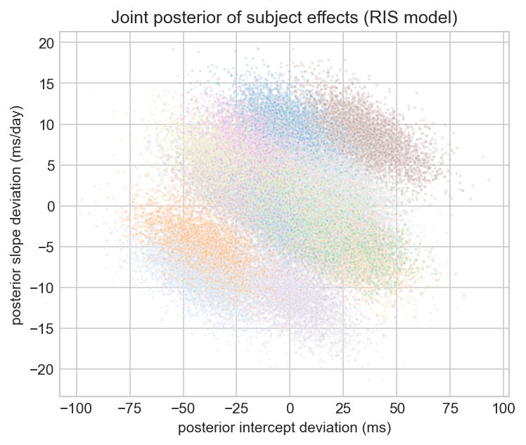

And here are the intercepts and slopes of all subjects with 94% intervals — compare with the lonely BLUP bars above:

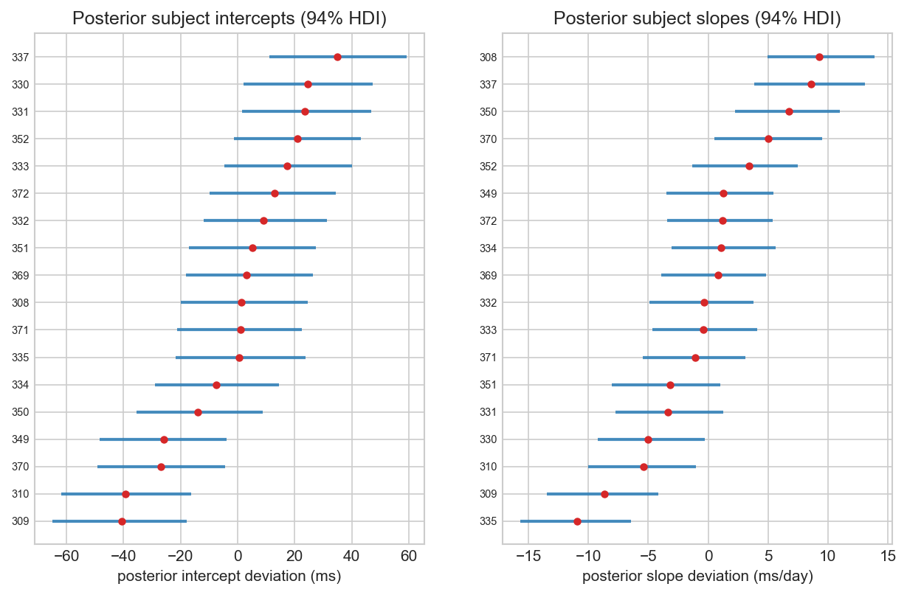

## Part 2. A longitudinal study of depression treatment

### The data

The second example has a binary outcome. The data come from Agresti's *Categorical Data Analysis* (Table 9.1): a longitudinal comparison of a new drug with a standard one in the treatment of depression. Patients were classified by initial severity (mild/severe), randomly assigned to one of the two drugs, and after 1, 2 and 4 weeks of treatment their condition was classified as normal (1) or abnormal (0). In total, 340 patients with three observations each — 1020 rows.

Coding: $s$ is severity (1 severe, 0 mild), $d$ is the drug (1 new, 0 standard), $t$ is time. When the time metric reflects cumulative dosage, the effect on the logit scale is often approximately linear in the logarithm of time, so weeks 1, 2, 4 are coded by the scores $t = \log_2(\text{week}) = 0, 1, 2$. Using the week numbers themselves gives similar substantive results.

Shares of "normal" by cell:

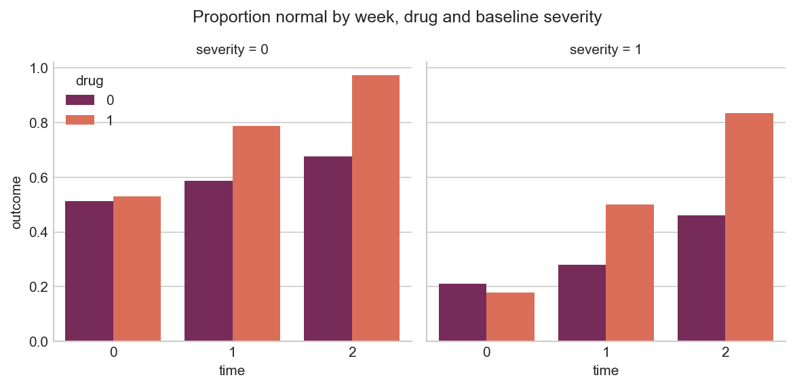

Reading the plot: both groups start near the level of their severity (mild ≈ 0.5, severe ≈ 0.2). On the standard drug, improvement is slow. On the new drug, by week 4 97% of the initially mild and 83% of the initially severe patients are classified normal. The gap between the drugs grows with time — a hint at a drug-by-time interaction that the model below confirms.

### Flat logistic models

First, the drug-only model:

```python
basic = smf.logit(formula='outcome ~ drug', data=data_depr).fit()
```

The drug coefficient is 0.72, the odds ratio ≈ 2.06: the new drug looks uniformly better. Then the full model with all predictors and the interaction:

```python
basic = smf.logit(formula='outcome ~ drug + time + severity + drug:time', data=data_depr).fit()
```

Estimates: intercept −0.03, drug −0.06, time 0.48, severity −1.31, drug-by-time interaction 1.02. The substantive result: the main effect of the drug vanishes while the interaction is large. At baseline the drugs do not differ; the difference grows with cumulative dose. A main effect without its interaction means nothing here — it is a time-averaged quantity.

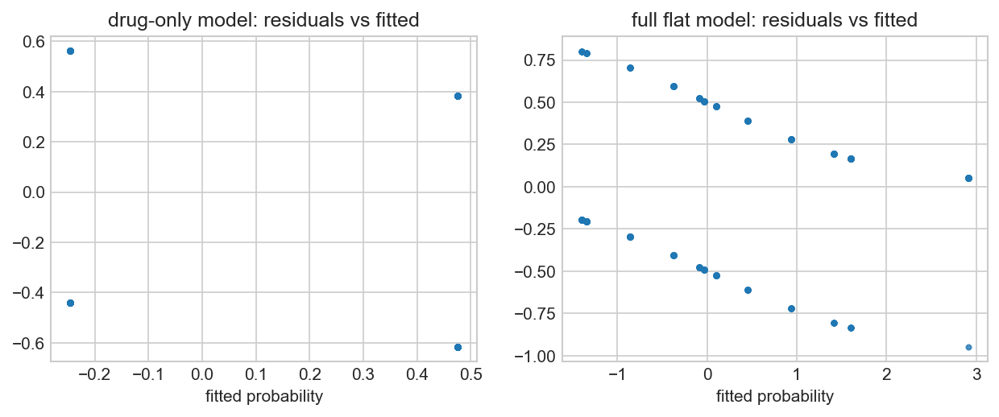

For binary data the residuals always form two bands (the values of $y - p$ are bounded), so the plot itself is not very informative. What matters is different: the flat model treats the 1020 rows as 1020 independent people. The standard errors are too small, and no transformation of the residuals fixes this — the clustering has to be modeled.

### The mixed model in statsmodels

Add a patient random intercept. The exact likelihood of a logistic mixed model requires numerical integration over 340 patient effects; statsmodels sidesteps it with a variational approximation:

```python
from statsmodels.genmod.bayes_mixed_glm import BinomialBayesMixedGLM

random = {'a': '0 + C(case)'}
mixed = BinomialBayesMixedGLM.from_formula(
    'outcome ~ drug + time + severity + drug:time', random, data_depr)
result = mixed.fit_vb()
```

The point estimates practically coincide with the flat model (−0.03, −0.06, 0.50, −1.35, 1.05), and the standard deviation of the patient random effects is estimated at ≈ 0.35. But this is exactly where the original notebook's complaint applies: looking at point estimates, everything seems the same — and there is nothing with which to assess quality or draw quantitative conclusions. By how much? What effect size? What uncertainty? The variational approximation returns approximate means and standard deviations, but no posterior samples, no assessment of its own quality, and no distribution for the random-effects variance — just one number.

### The Bayesian mixed model in Bambi

The same three models in Bambi: the flat drug-only model, the full flat model, and the full model with a patient random intercept:

```python
model1 = bmb.Model("outcome ~ drug", data_depr, family="bernoulli")
model2 = bmb.Model("outcome ~ drug + time + severity + drug:time",
                   data_depr, family="bernoulli")
model3 = bmb.Model("outcome ~ drug + time + severity + drug:time + (1 | case)",
                   data_depr, family="bernoulli")
idata3 = model3.fit(draws=1000, tune=1000, chains=4, target_accept=0.95,
                    random_seed=2026)
```

Comparison by PSIS-LOO:

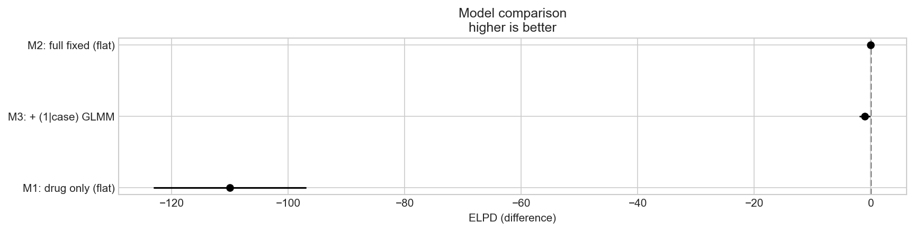

The full flat model and the mixed model are practically indistinguishable (the difference is below one ELPD unit); the drug-only model loses by a wide margin. The reason is clear from the posterior of the random-effects standard deviation:

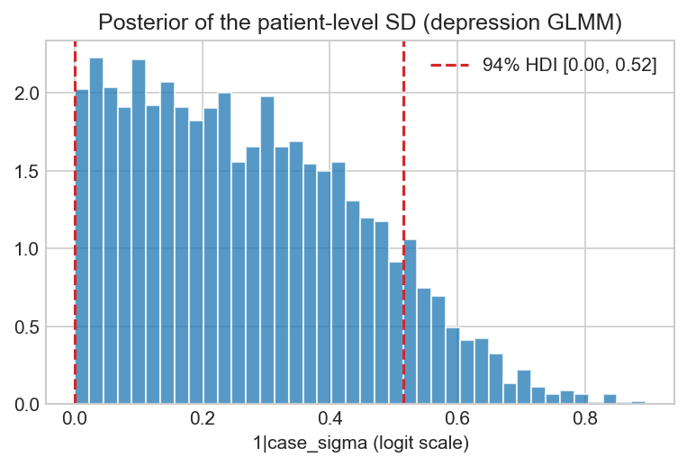

The between-patient variance concentrates near zero (mean ≈ 0.3, most mass below 0.6): each patient contributes only three binary observations, and the data cannot distinguish "patients do not differ" from "there are differences, but small ones". Partial pooling degenerates into complete pooling. This is not a verdict against hierarchical models: in the first example, where each subject contributed ten continuous observations, the hierarchical structure won decisively. Hierarchy pays off when clusters are informative — not merely because rows repeat.

A separate remark on convergence: with a weakly identified variance piling up near zero, occasional divergences occur even at `target_accept=0.95` — the same geometry discussed in Lesson 6. Read the numbers above after checking `r_hat` and ESS.

### Reporting on the probability scale

Logistic-regression coefficients live on the log-odds scale; a substantive conclusion requires translating them into probabilities at explicitly named conditions. For a typical patient the mixed model gives:

| Severity | Drug | Week 1 | Week 2 | Week 4 |
|---|---|---|---|---|
| mild | standard | 0.49 [0.42, 0.57] | 0.61 [0.55, 0.67] | 0.72 [0.66, 0.79] |
| mild | new | 0.48 [0.40, 0.56] | 0.81 [0.76, 0.85] | 0.95 [0.93, 0.97] |
| severe | standard | 0.20 [0.15, 0.25] | 0.29 [0.25, 0.34] | 0.41 [0.33, 0.48] |
| severe | new | 0.20 [0.14, 0.25] | 0.53 [0.47, 0.59] | 0.83 [0.78, 0.89] |

(94% intervals in brackets; the table matches the figure)

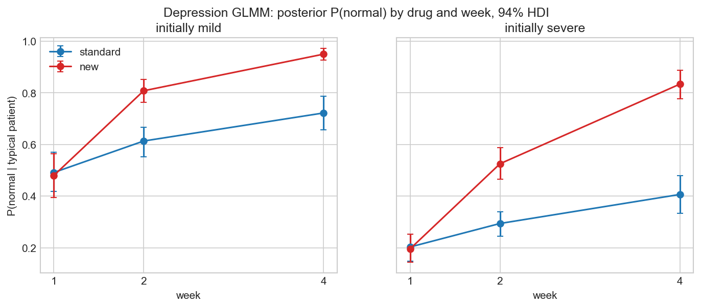

By week 4 the new drug raises the probability of a normal classification by $+0.23$ in the initially mild group (94% interval $[+0.17, +0.29]$) and by $+0.43$ in the severe group ($[+0.34, +0.51]$). That is the answer to the question "by how much" — with its uncertainty.

## Part 3. When groups do not repeat: voting in ANES 2016

Not all binary data are longitudinal. The same toolkit is useful for heterogeneous groups in a single cross-section. In the ANES 2016 data we model the Clinton vote:

```python
clinton_model = bmb.Model("vote['clinton'] ~ party_id + party_id:age",
                          clinton_data, family="bernoulli")
```

The formula gives every party its own age slope: the `party_id:age` interaction expands into three coefficients (democrats, independents, republicans), so a separate main effect of age is not needed and not missing. `vote['clinton']` means that a Clinton vote counts as success.

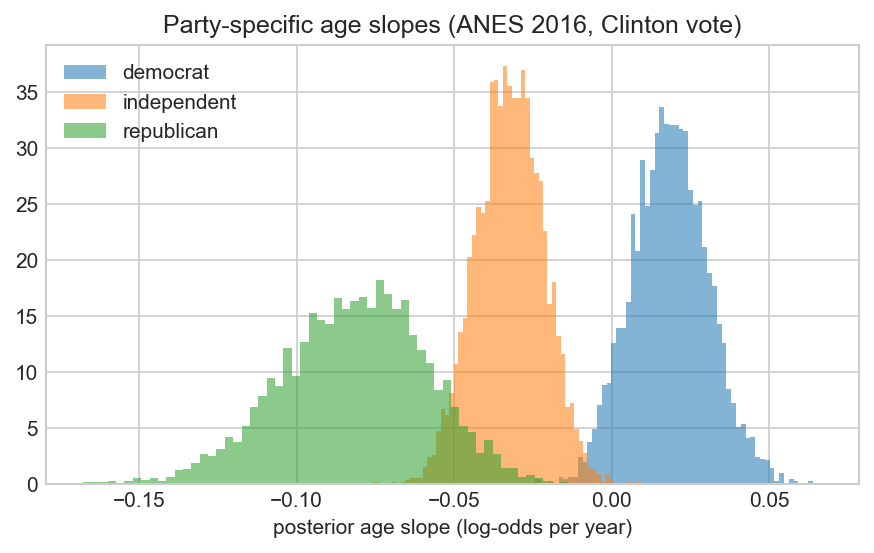

The parties' slopes barely overlap. In probability terms: per decade of age, the probability of a Clinton vote changes by $+0.035$ among democrats (94% interval covers zero: $[-0.006, +0.088]$), by $-0.049$ among independents ($[-0.066, -0.033]$), and by $-0.151$ among republicans ($[-0.224, -0.083]$) — each evaluated at that party's own baseline probability. A single "average" age effect would have hidden the whole picture: interactions make heterogeneity visible.

## Homework

**Pig growth (`dietox`).** Build a mixed model for the pig growth data (file `data/dietox.csv`; the description and results are available in most packages: doBy/data-dietox). The weight of slaughter pigs was measured weekly for 12 weeks; the treatments are three levels of vitamin E (`Evit`: 0, 100, 200 mg/kg feed) combined with three levels of copper (`Cu`: 0, 35, 175 mg/kg); cumulated feed intake (`Feed`), litter (`Litter`) and start weight are also recorded. Tutorials usually consider only the dependence on time — look at the other variables too, and try different models.

**Chimpanzees (Lesson 10 capstone).** Apply the approach of Part 2 to the prosocial chimpanzees data (`data/chimpanzees.csv`): the flat model `pulled_left ~ prosoc_left * condition` versus the mixed model `pulled_left ~ prosoc_left * condition + (1 | actor) + (1 | block)`, a PSIS-LOO comparison, and a report on the effect of the prosocial option with its uncertainty.

## Summary

- Repeated measurements break the independence of observations; pooled OLS produces standard errors that are too small (here, Durbin–Watson 0.7 with 180 rows and 18 independent units).
- Subject dummies fix the intercepts but overfit, cannot generalize to new people, and impose a common slope.
- Mixed models estimate both the population effects and the variance components — including the covariance of random intercepts and slopes in statsmodels. Their blind spot is the uncertainty of the variance components: BLUPs without intervals, one number instead of a distribution.
- Bayesian hierarchical models in Bambi give the same point results but as full posterior distributions — including the honest conclusion "the differences between clusters are small", as in the depression trial.
- The choice between model structures is made by out-of-sample predictive accuracy (PSIS-LOO), not by the significance of coefficients.
- Substantive conclusions for binary outcomes are stated on the probability scale at explicitly named conditions.

```{seealso}
- {doc}`10.HierarchicalModelsPartialPooling` — Lesson 9: the theory of adaptive shrinkage and Neal's funnel, and its main workbook
- {doc}`10.PartialPoolingChimpanzees` — Lesson 10 capstone: hierarchical logit on the prosocial chimpanzees data
- {doc}`9.GeneralizedLinearModels` — Lesson 10: binary outcomes and the logistic link
```
