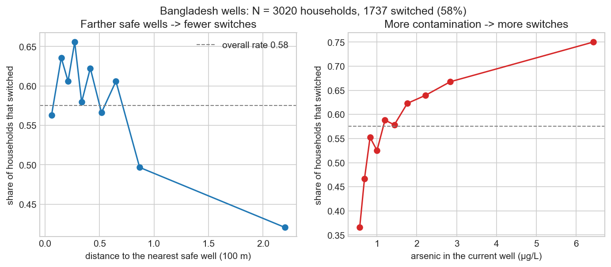
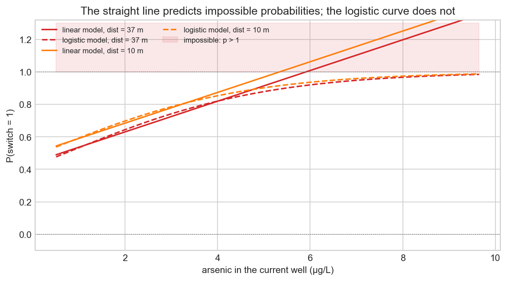
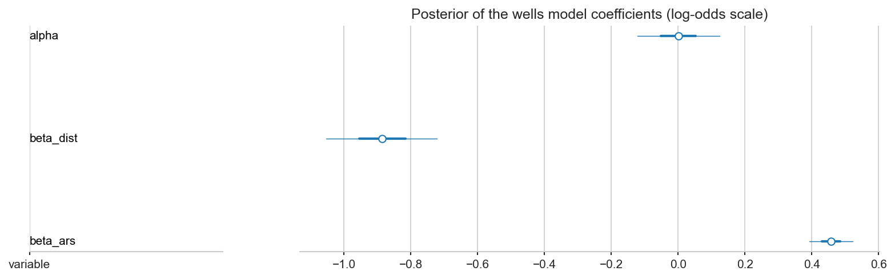
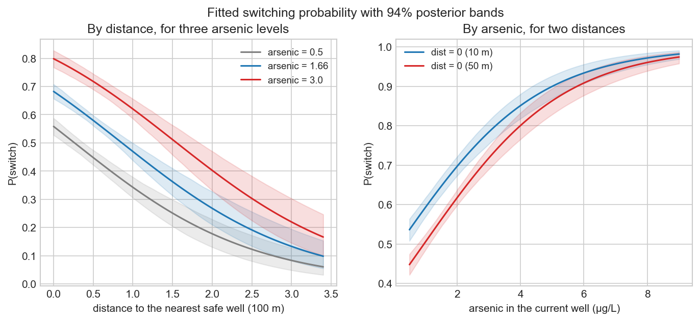
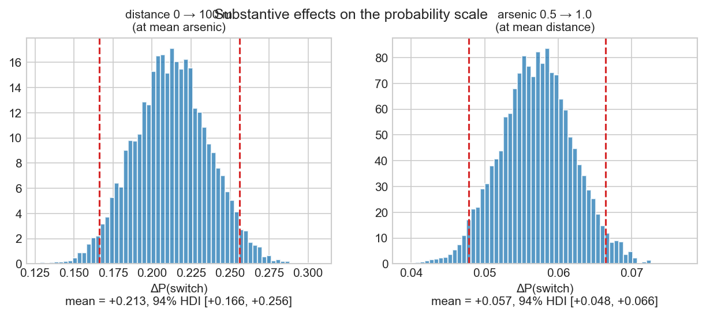
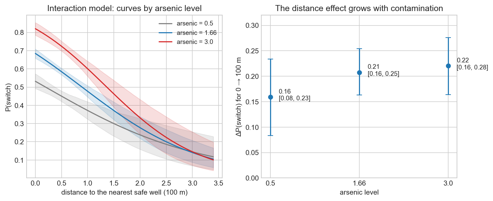
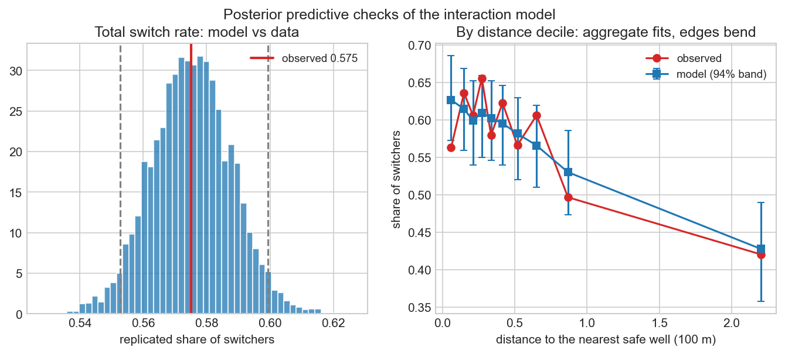
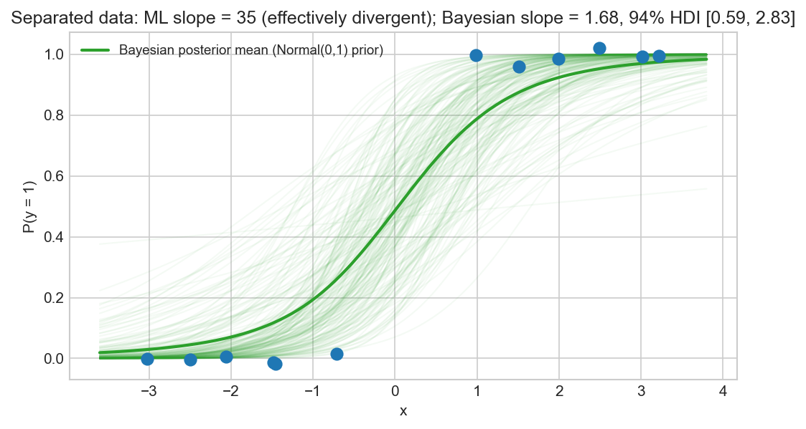

# Занятие 10. Бинарные исходы и обобщённые линейные модели (GLM)

*Русская версия. [English version](/en/generalizedlinearmodels)*

[](https://colab.research.google.com/github/iknyazeva/bayes-cogsci-book/blob/main/notebooks/colab/10_generalized_linear_models_ru.ipynb) русская рабочая тетрадь · [English workbook](https://colab.research.google.com/github/iknyazeva/bayes-cogsci-book/blob/main/notebooks/colab/10_generalized_linear_models.ipynb)

> **Главный вопрос занятия:** когда исход — это бинарный выбор (0 или 1), как построить регрессию, которая всегда выдаёт корректные вероятности, и как перевести её коэффициенты на понятную шкалу процентов?

На занятиях 7–9 исход был непрерывным: баллы тестов в KidIQ, время реакции в эксперименте со сном. Но в психологии и когнитивных науках исход очень часто — дискретное решение: вспомнил или забыл, согласился или отказался, выбрал левый или правый рычаг. Всё занятие мы разбираем один реальный пример — смену колодцев с мышьяком в Бангладеш — и проходим путь от «почему обычная регрессия здесь не работает» до полноценной байесовской логистической модели с интерпретацией на шкале вероятностей.

## 1. Данные: колодцы с мышьяком в Бангладеш

В округе Арайхазар в Бангладеш (*Gelman, Hill, Vehtari, «Regression and Other Stories»*, гл. 13–14) исследователи опросили $N = 3020$ семей, чьи колодцы содержали опасную концентрацию мышьяка. Каждой семье сообщали результат анализа и указывали на ближайший безопасный колодец. Спустя некоторое время проверяли, сменила ли семья источник воды.

- **Исход** $y_i \in \{0, 1\}$: сменила ли семья колодец (1) или продолжила пользоваться старым (0). Сменили 57.5% семей.
- **Предикторы**:
  - `dist100` — расстояние до ближайшего безопасного колодца в сотнях метров (от 0 до 3.4, в среднем 0.48);
  - `arsenic` — концентрация мышьяка в текущем колодце в мкг/л (от 0.51 до 9.65, в среднем 1.66).

Прежде чем строить какую-либо модель, посмотрим на данные — доли сменивших колодец по децилям расстояния и мышьяка:



Обе зависимости видны сразу: чем дальше безопасный колодец, тем меньше семей его выбрали; чем сильнее загрязнён свой, тем больше семей сменили. Наша задача — оценить эти эффекты количественно и с неопределённостью.

## 2. Почему прямая линия не подходит

Попробуем применить знакомую линейную регрессию напрямую — предсказывать сам бинарный исход. Такая модель называется линейной моделью вероятности. Подгонка по обоим предикторам даёт:

$$\widehat{P}(\text{смена}) = 0.515 - 0.20 \cdot \text{dist100} + 0.094 \cdot \text{arsenic}.$$

Модель ломается буквально: для 21 из 3020 семей она предсказывает «вероятности» больше единицы (максимум 1.28 — для семей рядом с безопасным колодцем при мышьяке 9.65) и для одной — меньше нуля. Вероятности вне $[0, 1]$ не существуют. Прямая бесконечна в обе стороны, а допустимый диапазон конечен — рано или поздно она из него выйдет.



Есть и вторая, менее очевидная проблема: у бинарного исхода дисперсия жёстко связана с вероятностью, $\operatorname{Var}(Y) = p(1-p)$ — она максимальна при $p = 0.5$ и падает к краям. Линейная регрессия с постоянной дисперсией остатков $\sigma^2$ здесь принципиально неверна.

Нужна кривая, которая всюду остаётся внутри $(0, 1)$ и приближается к 0 и 1 плавно, не по прямой.

## 3. Логистическая модель

Аппарат обобщённых линейных моделей (Nelder, Wedderburn, 1972) предлагает строить модель в три шага.

**Шаг 1. Линейный предиктор** — как в обычной регрессии, без ограничений:

$$\eta_i = \alpha + \beta_1 x_{1i} + \dots + \beta_k x_{ki} \in (-\infty, \infty).$$

**Шаг 2. Обратная логистическая связь** сжимает $\eta_i$ в вероятность:

$$p_i = \operatorname{logit}^{-1}(\eta_i) = \frac{1}{1 + e^{-\eta_i}} \in (0, 1).$$

**Шаг 3. Правдоподобие**: каждый observed ответ — Бернулли с полученной вероятностью:

$$y_i \sim \operatorname{Bernoulli}(p_i).$$

Слева на интерактивном рисунке — сама S-кривая: одинаковый сдвиг $\eta$ на 0.8 даёт разный прирост вероятности в зависимости от того, где мы находимся (примерно 19 процентных пунктов при $p = 0.5$, но лишь 2.7 п.п. при $p = 0.95$). Справа — зачем нужны аккуратные приоры: «широкое» априорное распределение $\operatorname{Normal}(0, 100)$ на шкале лог-шансов на самом деле экстремально — оно выталкивает 97.6% априорной массы к вероятностям, близким к 0 или 1.

<iframe src="../_static/fig9_logit_baselines.html?v=1" width="100%" height="410px" style="border:none; border-radius:8px;"></iframe>

## 4. Байесовская модель колодцев в PyMC

Собираем модель с масштабно-согласованными приорами. На шкале лог-шансов $\operatorname{Normal}(0, 1.5)$ для интерсепта означает: до данных мы считаем правдоподобными базовые вероятности примерно от 5% до 95%, а $\operatorname{Normal}(0, 1)$ для коэффициентов — что эффект предиктора вряд ли переворачивает вероятность от почти 0 до почти 1:

```python
import pymc as pm

with pm.Model() as wells_model:
    # 1. Априорные распределения на шкале лог-шансов
    alpha = pm.Normal("alpha", mu=0.0, sigma=1.5)
    beta_dist = pm.Normal("beta_dist", mu=0.0, sigma=1.0)
    beta_ars = pm.Normal("beta_ars", mu=0.0, sigma=1.0)

    # 2. Линейный предиктор
    eta = alpha + beta_dist * dist100 + beta_ars * arsenic

    # 3. Логистическая связь и правдоподобие Бернулли
    p = pm.Deterministic("p", pm.math.invlogit(eta))
    pm.Bernoulli("switch_obs", p=p, observed=switch)

    idata = pm.sample(draws=2000, tune=1000, chains=4,
                      target_accept=0.95, random_seed=2026)
```

Апостериорные распределения коэффициентов (сходимость в порядке: `r_hat` = 1.00, ESS в тысячах):

| Параметр | Среднее | 94% HDI | Смысл |
|---|---|---|---|
| $\alpha$ | 0.00 | $[-0.15, 0.15]$ | лог-шансы смены при dist = 0 и мышьяке = 0 — формальная точка отсчёта у края данных (мышьяк ниже 0.5 в данных не встречается) |
| $\beta_{\text{dist100}}$ | $-0.89$ | $[-1.08, -0.69]$ | каждые 100 м до безопасного колодца снижают лог-шансы смены на 0.89 |
| $\beta_{\text{arsenic}}$ | $+0.46$ | $[0.38, 0.53]$ | каждая дополнительная единица мышьяка повышает лог-шансы смены на 0.46 |



Знаки согласуются с картинкой данных, интервалы узкие — эффекты надёжные. Но коэффициенты пока живут на шкале лог-шансов, а на ней никто не думает. Переведём.

## 5. Интерпретация на шкале вероятностей

### Правило деления на 4

Логистическая кривая круче всего в середине, при $p = 0.5$, где её наклон равен ровно $1/4$. Отсюда мгновенная оценка сверху:

$$\Delta p \le \frac{\beta}{4}.$$

Для $\beta_{\text{dist100}} = -0.89$: сто метров пути — это не более $0.89/4 \approx 22$ процентных пунктов снижения; для $\beta_{\text{arsenic}} = 0.46$ — не более $0.46/4 \approx 11$ п.п. роста на единицу мышьяка. Реальный эффект почти всегда меньше, потому что кривая выполаживается к краям.

### Главное правило: эффект зависит от начальной точки

Один и тот же сдвиг $\eta$ даёт разный прирост вероятности в зависимости от базовой вероятности. Сдвиг $\beta = 0.8$ при базовой вероятности 0.50 поднимает её до $\approx 69\%$ ($+19$ п.п.), а при базовой 0.95 — лишь до $\approx 97.7\%$ ($+2.7$ п.п.). Поэтому содержательные выводы всегда считают при явно названных условиях — как в следующих двух графиках.



Слева — вероятность смены как функция расстояния при трёх уровнях мышьяка; справа — как функция мышьяка при двух расстояниях. Полосы — 94%-е апостериорные интервалы: неопределённость растёт к краям диапазона, где данных меньше.

Теперь количественные ответы на содержательные вопросы:



- **Дистанция.** При среднем мышьяке (1.66) увеличение пути от 0 до 100 метров снижает вероятность смены на $0.21$ (94% HDI $[0.17, 0.26]$) — с 68% до 47%.
- **Мышьяк.** При среднем расстоянии (48 м) рост загрязнения с 0.5 до 1.0 повышает вероятность смены на $0.06$ ($[0.05, 0.07]$) — эффект мал, потому что базовые вероятности здесь умеренные, но абсолютно надёжный: интервал далеко от нуля.

Сравните: «$\beta_{\text{dist100}} = -0.89$ лог-шансов» против «+100 метров пути — минус 21 процентный пункт вероятности смены [17, 26]». Второе понимает любой.

## 6. Доделываем анализ: взаимодействие и проверка модели

### Зависит ли эффект расстояния от загрязнения?

До сих пор мы предполагали, что эффекты расстояния и мышьяка складываются независимо. Проверим это: добавим в модель произведение предикторов.

```python
with pm.Model() as wells_int_model:
    alpha = pm.Normal("alpha", mu=0.0, sigma=1.5)
    beta_dist = pm.Normal("beta_dist", mu=0.0, sigma=1.0)
    beta_ars = pm.Normal("beta_ars", mu=0.0, sigma=1.0)
    beta_int = pm.Normal("beta_int", mu=0.0, sigma=1.0)
    eta = alpha + beta_dist * dist100 + beta_ars * arsenic \
          + beta_int * dist100 * arsenic
    p = pm.Deterministic("p", pm.math.invlogit(eta))
    pm.Bernoulli("switch_obs", p=p, observed=switch)
    idata_int = pm.sample(draws=2000, tune=1000, chains=4,
                          target_accept=0.95, random_seed=2026)
```

Коэффициент взаимодействия: $\beta_{\text{int}} = -0.19$, 94% HDI $[-0.38, 0.00]$ — слабый, но содержательно осмысленный (в ROS получается такое же значение, −0.18). Прочитать его проще через эффекты на шкале вероятностей:



- при мышьяке 0.5: +100 м пути — минус 16 п.п. (с 53% до 37%);
- при среднем мышьяке 1.66: минус 21 п.п. (с 68% до 48%);
- при мышьяке 3.0: минус 22 п.п. (с 82% до 60%).

То же самое другими словами: высокая загрязнённость сильнее всего мотивирует смену, когда безопасный колодец рядом; если идти далеко, даже сильный мышьяк мотивирует слабее. Отрицательный коэффициент взаимодействия означает, что два мотива не складываются: эффекты замещают друг друга.

### Постериорная предсказательная проверка

Сгенерируем из апостериорного распределения новые копии данных и сравним их с настоящими:



Слева — суммарная доля сменивших: наблюдаемое значение 0.575 стоит точно в центре предсказательного распределения $[0.553, 0.599]$. Справа — проверка по децилям расстояния: в среднем модель воспроизводит спад, но на самых коротких дистанциях слегка завышает долю сменивших (0.63 против наблюдаемых 0.56). Это честный сигнал, что модель не всё улавливает: в полном анализе ROS в модель дополнительно входят образование и другие предикторы — их добавление остаётся упражнением в рабочей тетради.

## 7. Полное разделение и байесовская регуляризация

Одна типичная беда логистической регрессии — полное разделение: если какой-то предиктор безошибочно разделяет нули и единицы, метод максимального правдоподобия не имеет конечного решения. На маленьком примере, где все точки с $x > 0$ имеют $y = 1$, а все точки с $x < 0$ — $y = 0$:



Оценка максимального правдоподобия улетает (наклон 35 с гигантской стандартной ошибкой — практически расходимость): данные можно разделить любой прямой с достаточно большим наклоном, и «лучшей» не существует. Байесовская модель с приором $\operatorname{Normal}(0, 1)$ остаётся конечной: наклон $1.68$, 94% HDI $[0.59, 2.83]$. Приор не запрещает сильный эффект, но требует данных, чтобы его подтвердить. В реальных данных колодцев полного разделения нет, но в редких подгруппах (мало наблюдений, крайние значения предикторов) оно случается — и аккуратные приоры это страхуют.

## 8. Общий рецепт: любые GLM устроены одинаково

Логистическая регрессия — частный случай общей схемы. Любая обобщённая линейная модель состоит из трёх компонентов: линейный предиктор $\eta_i = \alpha + \beta_1 x_{1i} + \dots + \beta_k x_{ki}$; функция связи $g$, связывающая среднее отклика с предиктором ($\eta_i = g(\mu_i)$); и распределение правдоподобия, описывающее случайность отклика. Меняется носитель исхода — меняются связь и правдоподобие:

| Тип данных | Семейство | Связь | Обратная связь | Пример |
|---|---|---|---|---|
| бинарные $\{0, 1\}$ | Бернулли / биномиальное | логит | $\frac{1}{1+e^{-\eta}}$ | выбор, правильный ответ, согласие |
| счётные $\mathbb{N}_0$ | Пуассон / отрицательное биномиальное | логарифм | $e^{\eta}$ | число фиксаций, число ошибок |
| порядковые $\{1, \dots, K\}$ | порядковый логит | кумулятивный логит | пороговые точки | шкалы Лайкерта |
| положительные времена $\mathbb{R}^+$ | экспоненциальное / гамма | логарифм | $e^{\eta}$ | время реакции, время ожидания |

К этой таблице мы будем возвращаться на следующих занятиях; сегодня полностью разобран её первый ряд.

## 9. Итоговый кейс части III: просоциальные шимпанзе

Занятие 9 дало иерархические модели с частичным объединением, занятие 10 — обобщённые линейные модели. В итоговом кейсе части III ({doc}`10.PartialPoolingChimpanzees`) они соединяются: эксперимент Silk et al. ($N = 504$ пробы у 7 шимпанзе) анализируется иерархической логистической регрессией, где каждый актор имеет свои сдвиги, а оценки сжимаются к популяционному среднему. Дополнительно к этому — тетрадь «Смешанные модели для бинарных данных» и страница «Классические смешанные модели и байесовская иерархия» переносят ту же логику на продольные данные клинического испытания.

## 10. Проверьте себя

```{dropdown} Вопрос на понимание: отношение шансов против абсолютного риска
В медицинском отчёте указано, что препарат снижает шансы побочного эффекта с отношением шансов $\text{OR} = 0.50$ ($\beta = \log(0.50) \approx -0.69$). Журналист пишет: «Препарат снижает риск осложнения в два раза!». Прав ли журналист?

**Ответ:** Нет. Отношение шансов 0.50 не означает уменьшения абсолютного риска в два раза. Если исходный риск составлял 50%, шансы падают с 1.0 до 0.5, что соответствует снижению вероятности с 50% до 33.3% ($\Delta p = -16.7$ п.п.). А если исходный риск был 1%, вероятность падает с 1% до примерно 0.5% ($\Delta p = -0.5$ п.п.). Отношения шансов всегда нужно переводить в абсолютные разности вероятностей при конкретной базовой вероятности — это ровно то же правило, что мы применяли к колодцам.
```

## Пункт исследовательского протокола

1. **Носитель исхода и связь**: укажите природу отклика (бинарный, счётный, порядковый) и обоснуйте выбор функции связи.
2. **Приорная проверка на шкале вероятностей**: убедитесь, что приоры коэффициентов не выталкивают вероятности к 0 и 1 (рисунок выше, правая панель).
3. **Отчёт на наблюдаемой шкале**: лог-шансы никогда не приводятся изолированно — только $\Delta p$ при названных базовых условиях.
4. **Аудит разделения**: проверьте редкие подгруппы на полное разделение.

## Главные выводы

- Бинарный исход требует правдоподобия Бернулли и логистической связи, удерживающей предсказания внутри $(0, 1)$; линейная модель вероятности выдаёт невозможные значения уже на реальных данных колодцев.
- Правило деления на 4 ($\Delta p \le \beta/4$) — мгновенная проверка максимума эффекта; настоящий эффект считают при явно названных базовых условиях: +100 м пути — это $-21$ п.п. $[17, 26]$, а не «$-0.89$ лог-шансов».
- Модель можно и нужно доделывать: проверка взаимодействия показала, что мотивы не складываются (эффект мышьяка сильнее при короткой дистанции), а постериорная предсказательная проверка честно показала, где модель недообъясняет данные.
- Аккуратные приоры — страховка от полного разделения: байесовская оценка остаётся конечной там, где оценка максимального правдоподобия расходится.
- Все GLM устроены одинаково: линейный предиктор + функция связи + правдоподобие; логистическая регрессия — первый и центральный пример этой схемы.

```{seealso}
- {doc}`10.PartialPoolingChimpanzees` — Итоговый кейс: иерархическая логистическая регрессия для экспериментов с шимпанзе
- {doc}`10.MixedModelsVsHierarchicalBayes` — Дополнительно: смешанные модели для бинарных продольных данных (GLMM депрессии, ANES) с исполняемой [тетрадью логистических смешанных моделей](https://colab.research.google.com/github/iknyazeva/bayes-cogsci-book/blob/main/notebooks/colab/10_mixed_models_logistic_ru.ipynb)
- {doc}`9.LogisticRegression` — Подробный разбор отношений шансов и калибровки логистических моделей
- {doc}`9.PoissonRegression` — Модели для счётных данных и учёт времени наблюдения (exposure offset)
- {doc}`9.OrderedLogisticRegression` — Модели для порядковых шкал Лайкерта и скрытые пороговые точки
- {doc}`9.ExponentialData` — Модели для положительных временных длительностей
```
